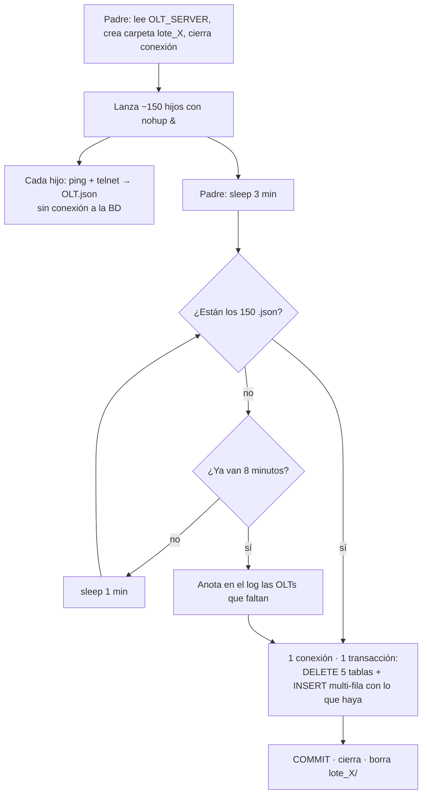

# 03 — bhaul-dev (192.168.66.121) · Aden.OLT_ALARMAS_CRITICAL — ⭐ NUESTRO

Volver a [[00 - Indice Bloqueos BD]] · Concepto: [[Conceptos - Metadata lock, TRUNCATE y lock_wait_timeout]]

## Lo que reportaron

- `Aden.OLT_ALARMAS_CRITICAL` desde `bhaul-dev@192.168.66.121`: espera máxima **420 s**.
- Acción pedida: usar una sola conexión o un pool chico, cerrarla al terminar e insertar en lotes (`INSERT … VALUES (…),(…)`) en vez de fila a fila.

## Proceso que escribe la tabla

El proceso de **alarmas OLT** (padre + hijos):

| Copia | Ruta local | Nota |
|---|---|---|
| Legacy (cron) | `C:\laragon\www\126\126_procesos\crontab127\OLT\Alarmas\Procesos\` | `crontab.txt` línea 88: corre **cada hora** (`00 */1 * * *`). Conecta como `adminAden`. |
| Migración PHP 8 | `C:\laragon\www\Pruebas\Migración\Procesos OLT\php_8_0\Alarmas_PHP8\Procesos\` | Desplegada en `/var/www/procesos/php/...`. Misma lógica. |
| Antiguas | `contingencia/`, `contingencia_v3/`, `panel_olt/` | Copias viejas; las pantallas que leen las tablas (`critical*.php`, `detalle_alarmas.php`) están ahí. |

> Por confirmar: cuál copia corre en 66.121 con el usuario `bhaul-dev`. La copia legacy usa `adminAden`, así que probablemente es la versión PHP 8 u otro despliegue.

### Qué hace hoy

**Padre** — `alarmas_proceso_detalle.php`
1. Registra la ejecución en `MONITOREO_PROCESOS_EJECUCIONES` (de ahí sale el `lote_id`).
2. `TRUNCATE` de **5 tablas**: `OLT_ALARMAS_CRITICAL`, `_MAJOR`, `_MINOR`, `_WARNING`, `OLT_CANTIDAD_ALARMAS_DETALLE`.
3. Por **cada OLT** de `OLT_SERVER` (~150) lanza un hijo con `nohup php … &` y termina sin esperarlos.

**Hijo** — `alarmas_proceso_detalle_exped.php` (uno por OLT)
1. Abre **su propia conexión** al inicio.
2. Hace ping y telnet a la OLT (`display alarm active all`, timeout de expect de 30 s por paso). **La conexión a la BD queda abierta y ociosa todo ese tiempo.**
3. Por cada alarma ejecuta un `INSERT` de **una fila** (autocommit). El bloque de las 4 severidades está copiado 5 veces (~200 líneas).
4. Inserta el resumen en `OLT_CANTIDAD_ALARMAS_DETALLE`, actualiza el monitoreo y cierra.

## Diagnóstico

| # | Problema | Efecto |
|---|---|---|
| D1 | ~150 hijos simultáneos, cada uno con su conexión | Ráfaga de ~150 conexiones cada hora contra la BD compartida. |
| D2 | La conexión se abre **antes** del telnet | Conexiones ociosas por minutos (y más si la OLT no responde). |
| D3 | `INSERT` fila a fila con autocommit | Miles de round-trips y commits; más tiempo con locks sobre la tabla. |
| D4 | `TRUNCATE` ×5 en el padre | Pide metadata lock exclusivo: espera a cualquier `SELECT` de las pantallas y encola a todos los demás. Además, durante la corrida las pantallas ven las tablas **vacías o a medio llenar**. |
| D5 | SQL concatenado (`'$alarma'`, `'$puerto'`) | Un apóstrofe en el texto de la alarma rompe el INSERT y el `or die()` mata al hijo. |

Otros hallazgos (no son de bloqueo, pero conviene anotarlos):
- Credenciales de telnet escritas en el código del hijo → moverlas al archivo de conexión o a variables de entorno. **No copiarlas a estas notas.**
- `@eregi_replace` no existe desde PHP 7 → revisar cómo quedó en la versión PHP 8.

## Etapa 1 — plan acordado: el padre revisa por ciclos, máximo 8 minutos

> Decisiones (2026-10-27):
> - Se siguen lanzando los ~150 hijos con `nohup … &`.
> - Los hijos **no tocan la BD**: hacen el telnet y dejan su resultado en un `.json`.
> - Después de lanzar el último hijo, el padre **espera 3 minutos** y revisa si ya están todas las OLTs. Si no, **espera 1 minuto y vuelve a revisar**, en un `for` con límite, hasta un **máximo de 8 minutos**.
> - Si se cumplen los 8 minutos y faltan OLTs, **inserta solo las que llegaron**.
> - La carga es **un solo DELETE + INSERT** en una conexión y una transacción.
> - **El monitoreo queda fuera** del diseño: el código de `MONITOREO_PROCESOS_EJECUCIONES` se deja **comentado**, no se borra.
> - Cada hijo se lanza con **`timeout 450`** (7,5 min).
>
> Plan de implementación paso a paso: [[03.1 - Plan implementacion etapa 1 alarmas OLT]]
>
> **2026-10-28: código implementado** en la copia PHP 8 (`Alarmas_PHP8/Procesos/`). Falta probarlo en el servidor (pasos 0, 3 y 4 del plan).

### Flujo



Tiempos: revisión a los **3, 4, 5, 6, 7 y 8 minutos** (1 espera de 3 min + 5 ciclos de 1 min = 8 min como máximo). Si a los 3 minutos ya están todas, carga a los 3 minutos.

> Por confirmar: lo entendí como **8 minutos en total** (3 + 5 ciclos). Si la idea era 3 min + 8 ciclos de 1 min (11 min en total), solo cambia el límite del `for`.

### Pasos del plan

**1. Padre** (`alarmas_proceso_detalle.php`)

1. Comentar el bloque de monitoreo (inicio y fin).
2. Generar el `lote_id` sin el monitoreo (hoy sale de su `insert_id`), por ejemplo `date('YmdHi')`.
3. Leer `OLT_SERVER`, guardar la lista de OLTs esperadas y **cerrar la conexión** antes de lanzar los hijos.
4. Crear `tmp/lote_<id>/`.
5. Quitar los 5 `TRUNCATE`.
6. Lanzar cada hijo con `nohup … &`, agregando `timeout` (ver paso 3) y la carpeta del lote como argumento.
7. Ciclo de espera y revisión (esquema):

```php
$esperados = count($olts);
sleep(180);                                    // espera inicial: 3 minutos
for ($ciclo = 0; $ciclo <= 5; $ciclo++) {      // revisa a los 3, 4, 5, 6, 7 y 8 minutos
    $listos = count(glob("$dir/*.json"));
    if ($listos >= $esperados) break;
    if ($ciclo < 5) sleep(60);
}
// Si no llegaron todas: anotar en el log cuáles faltan y seguir con las que hay
```

8. Leer los `.json` que existan y juntar las filas por severidad.
9. Abrir **una** conexión → `SET SESSION lock_wait_timeout = 10` → transacción → `DELETE` de las 5 tablas → INSERT multi-fila por tabla (máximo 5.000 filas por INSERT, ver abajo) → `COMMIT`. Si algo falla, `ROLLBACK` y las tablas quedan con los datos de la hora anterior.
10. Cerrar la conexión y borrar la carpeta del lote.

**2. Hijo** (`alarmas_proceso_detalle_exped.php`)

1. Quitar la conexión a la BD y comentar el bloque de monitoreo.
2. Recibir la carpeta del lote como argumento.
3. Cambiar cada `INSERT` por agregar la fila a un arreglo por severidad. De paso, juntar los 5 bloques copiados en una función `registrar_alarma()`.
4. Al terminar, escribir `<OLT>.json` con las alarmas y el resumen de cantidades. Escribirlo primero a `.tmp` y luego hacer `rename`, para que el padre nunca lea un archivo a medio escribir.
5. Escribir el `.json` también cuando falla el ping o el telnet (con estado `SIN_PING` o `TELNET_ERROR`), así el padre no espera por una OLT que ya terminó.

**3. Límite por hijo con `timeout`**

**Decidido: `timeout 450` (7,5 min) en cada `nohup`**, por debajo del límite de 8 min del padre. Así, cuando el padre carga a los 8 minutos, **ningún hijo sigue vivo**: no quedan procesos huérfanos ni archivos que lleguen tarde a una carpeta ya borrada.

```php
shell_exec("nohup timeout 450 php -f $hijo $ip $server $region $lote_id $dir > $logs/$server.log 2>&1 &");
```

**4. Carga en bloques**

Un INSERT multi-fila viaja en un solo paquete, limitado por `max_allowed_packet` (64 MB por defecto en MySQL 8, 4 MB en 5.7). Ejemplo: 150 OLTs × 50 alarmas ≈ 7.500 filas × ~150 bytes ≈ 1 MB, así que cabe. Igual se trocea con un **máximo de 5.000 filas por INSERT** (si hay más, se hacen más INSERT) **dentro de la misma transacción**: para la BD sigue siendo una sola carga.

### Qué se logra

| Problema | Cómo queda |
|---|---|
| D1, D2 | De ~150 conexiones a **1**, abierta solo durante la carga (segundos). |
| D3 | **Un INSERT por tabla** con las filas de todas las OLTs. |
| D4 | Sin `TRUNCATE`: `DELETE` + `INSERT` en **la misma transacción**. Las pantallas ven los datos de la hora anterior hasta el `COMMIT` y después los nuevos completos. **Resuelve también la etapa 2.** |
| D5 | Sentencias preparadas: las comillas en el texto de la alarma no rompen nada. |

### Sobre el padre esperando

Mientras está en `sleep()`, el padre **no usa CPU**: solo ocupa la memoria de un proceso PHP (pocos MB), y cada revisión es contar archivos en una carpeta. Lo que cargaba el servidor eran los ~150 PHP con telnet y conexión abierta a la BD al mismo tiempo, no un proceso dormido.

### Casos borde

| Caso | Qué pasa |
|---|---|
| Todas responden antes de 3 min | Carga a los 3 min. |
| Una OLT tarda 5 min (sin importar en qué orden se lanzó) | Carga a los 5 min, en la revisión en que aparece su archivo. |
| Una OLT no responde | `timeout` mata al hijo a los 7,5 min; a los 8 min el padre carga sin esa OLT y la anota en el log. |
| Falla la carga (BD caída, lock) | `ROLLBACK`: las tablas quedan con los datos de la hora anterior y la carpeta del lote queda para revisar. |
| OLT sin respuesta | No aparece en `OLT_CANTIDAD_ALARMAS_DETALLE`. Decidir si se inserta igual con ceros. |

## Alternativa evaluada (descartada): cierre por conteo, sin padre esperando

Cada hijo, al terminar, toma un candado (`flock`) y cuenta los `.json`. El que **completa la cuenta** (no el último lanzado, sino el que termina último, sin importar el orden) hace la carga.

- A favor: carga apenas termina la OLT más lenta y no queda ningún proceso esperando.
- En contra: más piezas (candado, archivo de "cargado", script de cierre extra) y más difícil de depurar. Si un hijo muere sin dejar archivo, hace falta un mecanismo extra.
- Se prefirió el ciclo del padre por ser más simple de leer, depurar y mantener.

## Checklist

- [ ] Confirmar qué copia corre en 66.121 / usuario `bhaul-dev` y desde dónde se lanza.
- [x] Confirmar si el máximo es 8 min en total o 3 + 8 ciclos. → 8 min en total (`MAX_CICLOS = 5`), según lo pedido ("8 minutos como máximo"); se cambia en una constante.
- [ ] `SELECT COUNT(*) FROM Aden.OLT_SERVER` (≈150) y cuántas alarmas hay por corrida → validar el tamaño del INSERT contra `max_allowed_packet`.
- [ ] Revisar en los logs cuánto tarda hoy la OLT más lenta → confirmar los 3 min iniciales y el `timeout` por hijo.
- [x] Padre: monitoreo comentado, `lote_id`, carpeta, sin `TRUNCATE`, `timeout` en el `nohup`, ciclo de espera, carga en una transacción. (2026-10-28)
- [x] Hijo: sin conexión, monitoreo comentado, `.json` siempre, `registrar_alarma()`. (2026-10-28)
- [ ] Decidir el tratamiento de las OLTs sin respuesta (¿fila con ceros?).
- [ ] Probar con 2–3 OLTs antes de desplegar; desplegar como lo defina el equipo.
- [ ] Verificar después con [[Consultas de diagnostico de bloqueos]] (conexiones por host y esperas de MDL).
